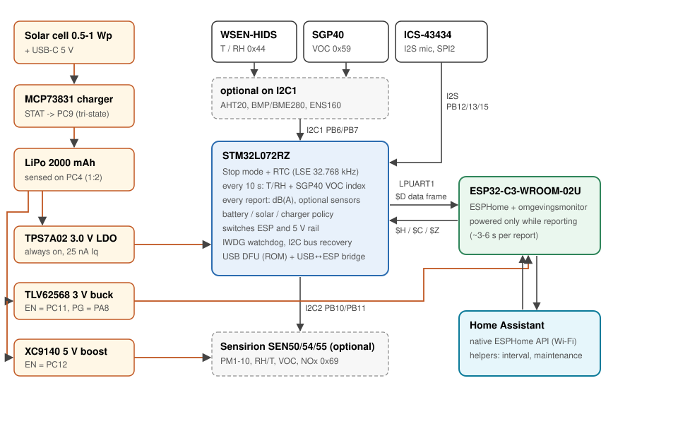
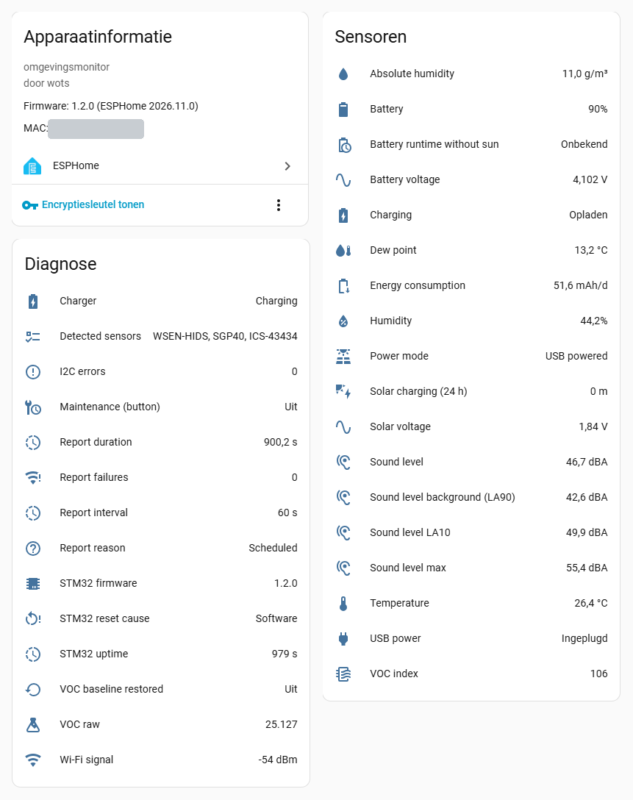
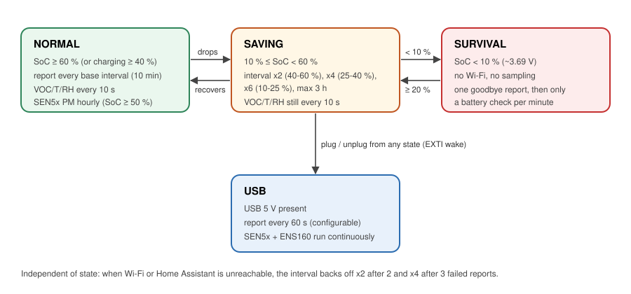

# De Omgevingsmonitor: lean firmware + ESPHome

A complete firmware rewrite for **[De Omgevingsmonitor](https://wiki.deomgevingsmonitor.nl/)**, the
WoTS 2024 environmental sensor gadget by KITT Engineering. It's designed to run on its solar
cell through a Dutch winter, and it shows up in Home Assistant as a normal ESPHome device.

* **STM32L072** (`stm32/`): bare-metal C on the STM32Cube HAL. It does all sensing and power
  management and spends almost all its time in Stop mode at a few µA.
* **ESP32-C3** (`esphome/`): ESPHome with a small external component. It only gets power while
  reporting (a few seconds), then the STM32 switches it off completely.
* **Home Assistant** (`homeassistant/`): optional helpers to change the report interval or keep
  the device awake for OTA, straight from HA.



## What it reports

| Sensor | Values | When |
| --- | --- | --- |
| WSEN-HIDS (on board) | temperature, humidity | sampled every 10 s |
| SGP40 (on board) | VOC index (Sensirion gas index algorithm), raw | sampled every 10 s, so the index stays valid |
| ICS-43434 (on board) | sound level LAeq, LAmax, background LA90 and LA10, dB(A) | 4 s window per report |
| Computed | dew point, absolute humidity | every report |
| Battery / solar / charger | voltage, %, solar voltage, charging, USB, solar charging minutes (24 h) | every report |
| Energy estimate | consumption (mAh/day), runtime without sun, report duration | every report |
| AHT20 *(optional)* | temperature, humidity | every report |
| BMP280 / BME280 *(optional)* | pressure, temperature (+ humidity) | every report |
| ENS160 *(optional)* | AQI, TVOC, eCO2 | on USB power |
| SEN50/54/55 *(optional)* | PM1/2.5/4/10, T/RH, VOC, NOx | continuously on USB; hourly PM on battery |
| Diagnostics | power mode, report reason, interval, reset cause, I2C errors, failed reports, uptime, Wi-Fi RSSI, detected sensors, VOC baseline restored | every report |

Optional sensors are detected at boot. If a sensor isn't fitted, nothing is published for it.

Smart behaviour:

* **Reports early on big changes**: a jump of 1.5 °C, 8 %RH or 80 VOC index points, or the VOC
  index crossing 250, triggers a report right away instead of waiting for the interval (at most
  4 per hour, not within 3 minutes of the previous report; only the VOC alarm in saving mode).
* **VOC baseline survives resets and flashing**: the gas index algorithm's learned state is kept
  in the RTC backup registers (no flash wear) and restored when it is less than 10 minutes old.
* **Battery life**: the STM32 estimates its own consumption from measured on-times; the Home
  Assistant package adds the 24 h battery trend and the battery life including the sun.



## Energy design



| Item | Estimate | Note |
| --- | --- | --- |
| Sleep floor (MCU Stop + RTC, LDO, sensors idle) | ~0.05–0.08 mA | **to be measured**; the original firmware drew ~2.3 mA |
| VOC/T/RH tick, ~0.25 s every 10 s | ~1.5 mAh/day | SGP40 hotplate heats 170 ms, then measures 30 ms |
| One report (sound 2.4 s + ESP ~4 s at ~80 mA) | ~0.09 mAh | static IP makes it shorter |
| **Total at 10 min interval** | **~16 mAh/day** | ≈ 110 days on 2000 mAh with no sun at all |
| Total in "saving" (40 min) | ~6 mAh/day | |

In practice, Wi-Fi time dominates. A fixed address is the single biggest saving: either a DHCP
reservation in your router, or a static IP in `esphome/local/network.yaml` (see
[esphome/local/README.md](esphome/local/README.md)), which also skips the DHCP round trip. The device also backs off by itself when Wi-Fi or HA is unreachable, and enters a
survival mode (no radio) below 10 % until the sun brings it back to 20 %.

## What changed compared with the original firmware

* **ESPHome instead of ESP-AT + openSenseMap.** It's a native HA device, and OTA works when you want it.
* **Every unused pin is parked as analog, and every peripheral is shut down before Stop.** The UART towards the
  unpowered ESP is no longer left driving its RX pin. `DBGMCU` is cleared at boot, so there's
  no more "reset twice to get low current".
* **The VOC index is actually valid on battery:** the SGP40 runs in Sensirion's 10 s low-power mode instead of
  a few samples per 15 minutes.
* **The hardware drives the timing:** the RTC wake-up timer, a watchdog on every path, I2C bus recovery and
  a hard 25 s limit on every Wi-Fi session. A missing access point can't drain the battery.
* **Removed:** openSenseMap upload, config web page/AP, LED effects, display support, USB
  console, CLI. Application code went from ~13,600 lines (v5.22) to ~2,600 on the STM32.

## Getting started

1. [Build and flash](docs/flashing.md). ESPHome goes on the ESP first, then the STM32 firmware; both over USB-C.
2. Adopt the device in Home Assistant (*Settings → Devices → ESPHome*, using the API key from `secrets.yaml`).
3. Optional: install the [HA helpers package](homeassistant/omgevingsmonitor_helpers.yaml) for interval and maintenance control.

### Buttons

| Button | Action |
| --- | --- |
| **User/VOC**, short | battery colour on the status LED + report now |
| **User/VOC**, 3 s | ESP stays on for 15 min (OTA, `esphome logs`), LED magenta |
| **User/VOC** held during reset | USB ⇄ ESP bridge for flashing ESPHome (LED blue) |
| **Boot/dB** held during reset | STM32 USB DFU bootloader |

## Repository layout

```text
stm32/                 STM32L072 firmware (PlatformIO, stm32cube)
  src/                 board, low-power, sensors, sound, link, bridge, settings
  lib/sensirion_gas_index/   Sensirion VOC algorithm (BSD-3-Clause, vendored)
  boards/              PlatformIO board definition
esphome/               ESPHome config + external component `omgevingsmonitor`
homeassistant/         HA package with helpers
docs/                  architecture, protocol, hardware notes, flashing guide
tools/                 A-weighting filter design / verification script
```

## Documentation

* [Hardware notes and pin map](docs/hardware.md)
* [STM32 ⇄ ESP protocol](docs/protocol.md)
* [Building and flashing](docs/flashing.md)
* Original material: [wiki](https://wiki.deomgevingsmonitor.nl/) ·
  [block diagram](https://wiki.deomgevingsmonitor.nl/index.php/Blokschema) ·
  [kittengineering/Omgevingsmonitor_Software](https://github.com/kittengineering/Omgevingsmonitor_Software) ·
  [BertHav/Omgevingsmonitor_Software](https://github.com/BertHav/Omgevingsmonitor_Software)

## Credits and licenses

* Hardware and the original firmware: KITT Engineering, Joris Blankestijn, Bert Havinga and contributors.
  This repository contains none of their code. The pin map and command sets were taken from their
  project for compatibility.
* `stm32/lib/sensirion_gas_index`: © Sensirion AG, BSD-3-Clause.
* STM32Cube HAL and USB device library: © STMicroelectronics, pulled from the PlatformIO package at
  build time. `stm32/include/stm32l0xx_hal_conf.h` is derived from ST's BSD-3-Clause template.
