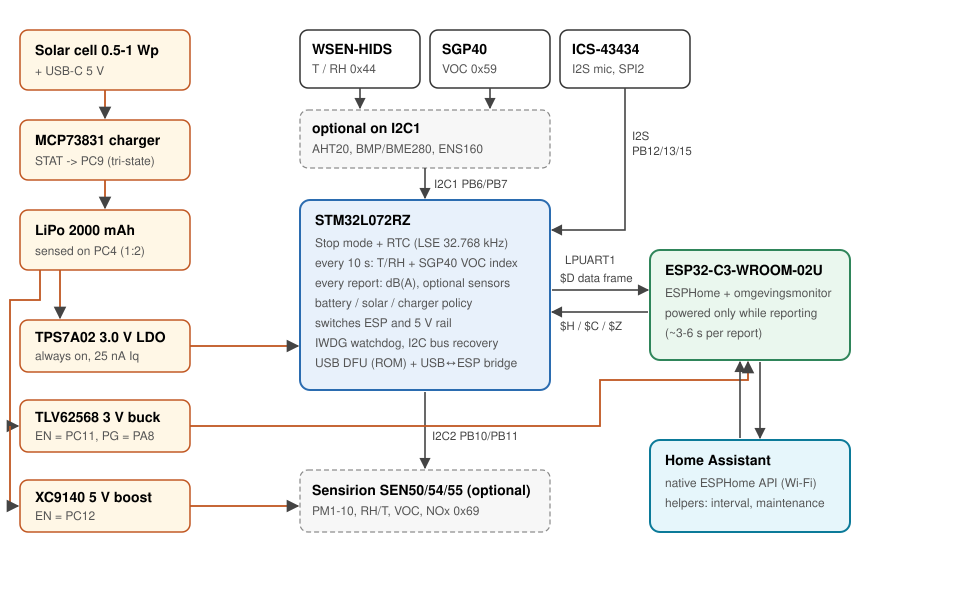

# Hardware notes

Collected from the original CubeMX project (`MJSGadget.ioc`), the firmware sources and
the published block diagram (Rev 5.0). **No schematic has been published.** Anything
marked *assumed* comes from reading the code, not from a schematic.

## Main parts

| Function | Part |
| --- | --- |
| MCU | STM32L072RZT6 (Cortex-M0+, 192 KB flash, 20 KB RAM, 6 KB EEPROM, USB FS) |
| Wi-Fi | ESP32-C3-WROOM-02U (4 MB flash, U.FL → SMA antenna) |
| Temp / RH | Würth WSEN-HIDS 2525020210002 (SHT4x-compatible commands, I2C 0x44) |
| VOC | Sensirion SGP40 (I2C 0x59) |
| Microphone | TDK InvenSense ICS-43434 (I2S, 24 bit, −26 dBFS @ 94 dB SPL) |
| Charger | Microchip MCP73831 (LiPo, STAT tri-state) |
| Battery | LiPo 3.7 V 2000 mAh |
| Solar | 0.5–1 Wp cell, Schottky OR-ing with USB |
| 3.0 V always-on | TI TPS7A02 LDO (MCU + on-board sensors) |
| ESP supply | TI TLV62568 3 V buck, switched (`PC11`), power-good (`PA8`) |
| 5 V sensor rail | Torex XC9140A501MR-G boost, switched (`PC12`) – SEN5x / expansion |
| RTC crystal | 32.768 kHz |

## STM32 pin map

| Pin | Function | Notes |
| --- | --- | --- |
| PA0 / PA2 / PA3 | LED B (R/G/B) | active low, unused by this firmware |
| PC6 / PC7 / PC8 | LED A (R/G/B) | active low, unused by this firmware |
| PB0 / PB8 / PB9 | LED C (R/G/B) | active low, **status LED** |
| PA1 / PC10 | USART4 RX / TX | to ESP (AT-firmware port), unused |
| PC0 / PC1 | LPUART1 | ESP UART0, **RX/TX swapped in peripheral** |
| PA9 / PA10 | USART1 TX / RX | debug log (TX only) |
| PA11 / PA12 | USB D− / D+ | DFU (ROM) + ESP bridge |
| PA13 / PA14 | SWD | left enabled |
| PA7 | VUSB detect | high = USB present, EXTI wake |
| PA8 | ESP supply power-good | input |
| PA15 | BOOT0 button sense | not used |
| PB6 / PB7 | I2C1 SCL / SDA | on-board sensor bus (3 V) |
| PB10 / PB11 | I2C2 SCL / SDA | 5 V-switched sensor bus (SEN5x) |
| PB12 / PB13 / PB15 | I2S2 WS / CK / SD | microphone |
| PC4 | battery voltage, ADC_IN14 | divider 1:2 |
| PC5 | solar voltage, ADC_IN15 | divider 1:3 |
| PC9 | charger STAT | tri-state |
| PC11 | ESP supply enable | |
| PC12 | 5 V boost enable | |
| PD2 | user button | active low, needs internal pull-up |
| PH0 / PH1 | ESP EN / ESP GPIO9 (boot strap) | EN active high; GPIO9 high = run |

## Buttons and LEDs (from the enclosure)

Left to right next to the USB-C port: **Reset/Status**, **Boot/dB**, **User/VOC**.

| Action | Result |
| --- | --- |
| Reset/Status | restart |
| Hold **Boot/dB**, press and release Reset/Status, release Boot/dB | STM32 ROM DFU bootloader (flash STM32) |
| Hold **User/VOC** while pressing Reset/Status | USB ⇄ ESP bridge, status LED blue (flash ESPHome) |
| Short press User/VOC | LED shows battery (green ≥ 50 %, yellow ≥ 20 %, red, blue = USB) + report now |
| Long press User/VOC (3 s) | LED magenta: ESP stays on for 15 min (OTA, logs) |

## Why the original firmware drew ~2.3 mA in standby

These are likely causes, still to be confirmed with a current meter:

* LPUART1 stayed initialised in Stop mode. Its TX pin idles high, which back-powers the
  ESP32 through its RX pin while the ESP supply is off.
* The USB peripheral and HSI48 stayed configured.
* A `DBG_STOP` bit left over from an ST-Link session keeps clocks running in Stop until
  a power-on reset. That would explain the "reset twice" advice in the original README.

This firmware parks every unused pin as analog, de-initialises every peripheral before
Stop and clears `DBGMCU->CR` at boot.
