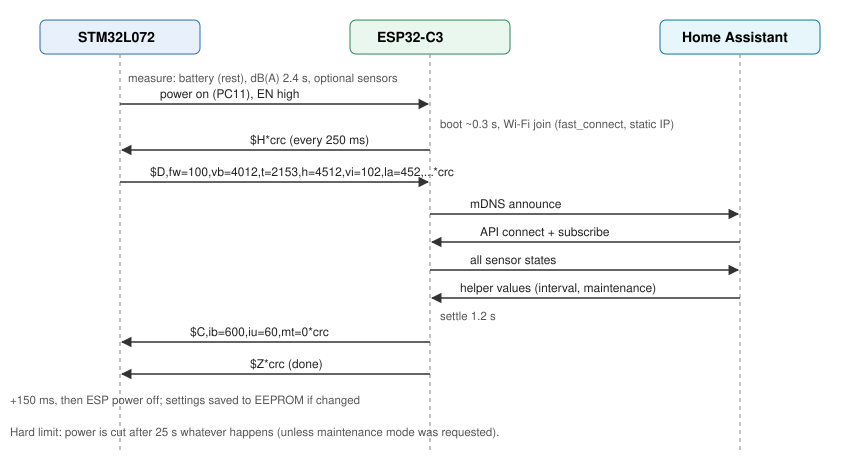

# STM32 ⇄ ESP32 link protocol

The STM32L072 talks to the ESP32-C3 over **LPUART1 ⇄ ESP UART0** (GPIO20 RX / GPIO21 TX),
115200 8N1. It's the same port the ESP is flashed through, so no extra wiring is involved.



## Framing

```
'$' TYPE [ ',' key '=' integer ]* '*' CRC '\n'
```

* `CRC` = CRC-16/CCITT-FALSE (poly 0x1021, init 0xFFFF) over the bytes between `$` and `*`, written as 4 upper-case hex digits.
* Everything that is not a valid line is ignored. That covers the ESP32 ROM boot log on UART0 and line noise while the ESP powers up.
* All values are integers with a fixed scale, so the STM32 never formats floats.

## Messages

| Dir | Type | Meaning |
| --- | --- | --- |
| ESP → STM | `H` | Hello. Sent every 250 ms until a data frame arrives. The STM32 answers each one with `D`. |
| STM → ESP | `D` | Data frame (keys below). In maintenance mode it's re-sent every 30 s. |
| ESP → STM | `C` | Settings from Home Assistant: `ib` battery interval s, `iu` USB interval s, `mt` maintenance seconds (0 = off). |
| ESP → STM | `Z` | Done. HA has the states, so the STM32 may cut power. Repeated every 500 ms. |

The STM32 removes power 150 ms after the first `Z`, or after `esp_timeout_s` (25 s) with no `Z`.
While a maintenance request (`mt` > 0, or a long press of the user button) is active, it ignores `Z` and the timeout.

## Data frame keys

| Key | Value | Scale | Present when |
| --- | --- | --- | --- |
| `fw` | STM32 firmware version | 100 = 1.0.0 | always |
| `up` | STM32 uptime | s | always |
| `rs` | reset cause | 0 power-on, 1 pin, 2 software, 3 watchdog, 4 low-power, 5 other | always |
| `ie` | I2C error counter | – | always |
| `pr` | detected sensors bitmask | b0 HIDS, b1 SGP40, b2 mic, b3 AHT20, b4 BMP280, b5 BME280, b6 ENS160, b7 SEN5x | always |
| `md` | power mode | 0 normal, 1 saving, 2 survival, 3 USB | always |
| `iv` | current report interval | s | always |
| `lf` | consecutive failed reports | – | always |
| `mt` | button maintenance active | 0/1 | always |
| `vb` | battery voltage (at rest) | mV | always |
| `bp` | battery state of charge | % | always |
| `vs` | solar voltage | mV | always |
| `us` | USB power present | 0/1 | always |
| `cs` | charger | 0 off, 1 charging, 2 full | always |
| `t`, `h` | WSEN-HIDS temperature / RH | °C×100, %×100 | HIDS ok |
| `vr`, `vi` | SGP40 raw / VOC index | –, 1..500 | SGP40 ok (index after learning starts) |
| `la`, `lx` | sound LAeq / LAmax (125 ms) | dB(A)×10 | mic ok |
| `at`, `ah` | AHT20 temperature / RH | °C×100, %×100 | AHT20 fitted |
| `bt`, `pa` | BMP/BME280 temperature / pressure | °C×100, Pa | BMP/BME280 fitted |
| `bh` | BME280 RH | %×100 | BME280 fitted |
| `es` | ENS160 validity | 0 ok, 1 warm-up, 2 initial start-up, 3 invalid | ENS160 running (USB) |
| `aq`, `tv`, `co` | ENS160 AQI / TVOC / eCO2 | 1-5, ppb, ppm | ENS160 valid |
| `p1`,`p2`,`p4`,`p0` | SEN5x PM1.0 / 2.5 / 4.0 / 10 | µg/m³×10 | SEN5x measured this round |
| `st`, `sh` | SEN5x temperature / RH | °C×100, %×100 | SEN5x |
| `sv`, `sn` | SEN5x VOC / NOx index | ×10 | SEN54/55 running continuously (USB) |

If a key is missing, the value keeps its last state in Home Assistant. The device reports
`has_deep_sleep`, so its entities don't go "unavailable" while the ESP is off.
